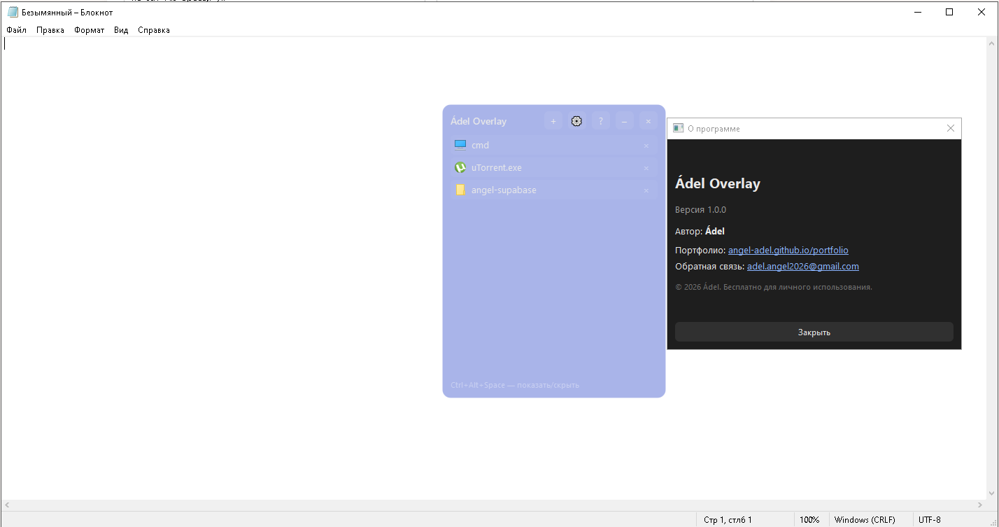

# Ádel Overlay

Бесплатный оверлей-лаунчер для Windows. Позволяет держать нужные файлы, папки и команды всегда под рукой, не сворачивая основное приложение.

# Ádel Overlay

Бесплатный оверлей-лаунчер для Windows. Позволяет держать нужные файлы, папки и команды всегда под рукой, не сворачивая основное приложение.

## Возможности
- **Поверх всех окон**: всегда на виду.
- **Быстрый доступ**: добавляйте ярлыки файлов, папок и команд.
- **Глобальный хоткей**: `Ctrl+Alt+Space` для мгновенного вызова.
- **Плавающая кнопка**: при сворачивании превращается в круглый шарик.
- **Кастомизация**: выбор цвета фона и настройка прозрачности.
- **Трей**: работа в фоне без захламления панели задач.

## Установка
Скачайте последний `AdelOverlay.exe` из раздела [Releases](../../releases).

## Технологии
- Python 3.14 + PyQt6
- PyInstaller
- pynput

## Автор
**Ádel** · [Портфолио](https://angel-adel.github.io/portfolio/) · [adel.angel2026@gmail.com](mailto:adel.angel2026@gmail.com) <!-- Замени на ссылку на картинку, когда загрузишь её в репозиторий -->

## Возможности
- **Поверх всех окон**: всегда на виду.
- **Быстрый доступ**: добавляйте ярлыки файлов, папок и команд.
- **Глобальный хоткей**: `Ctrl+Alt+Space` для мгновенного вызова.
- **Плавающая кнопка**: при сворачивании превращается в круглый шарик.
- **Кастомизация**: выбор цвета фона и настройка прозрачности.
- **Трей**: работа в фоне без захламления панели задач.

## Установка
Скачайте последний `AdelOverlay.exe` из раздела [Releases](../../releases).

## Технологии
- Python 3.14 + PyQt6
- PyInstaller
- pynput

## Автор
**Ádel** · [Портфолио](https://angel-adel.github.io/portfolio/) · [adel.angel2026@gmail.com](mailto:adel.angel2026@gmail.com)
